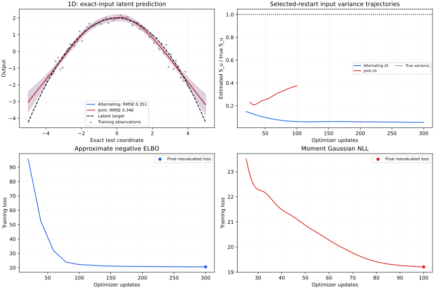
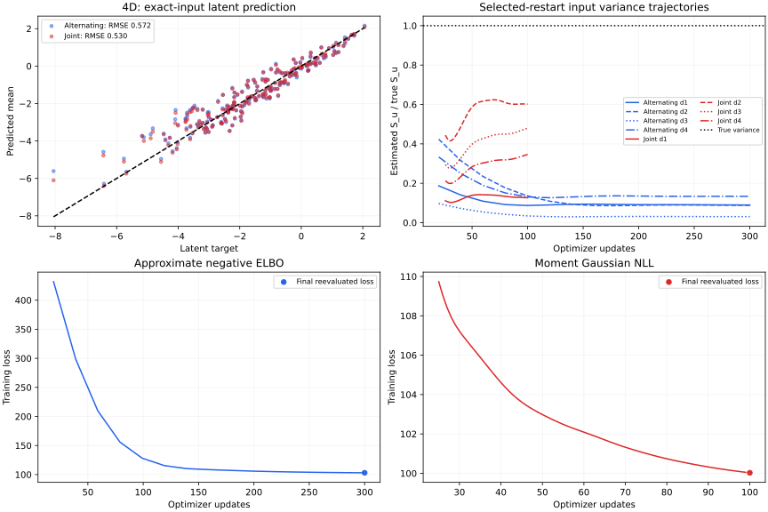

# NNGP-EIV comparison after the Delta-method correction

Run: 2026-10-08T10:48:57.523397+00:00. Branch: `fix/nngpeiv-delta-method`.

## Methods and protocol

- **Alternating:** second-order approximation of the expected Gaussian log likelihood, minus the Gaussian input KL. Its training objective is an approximate ELBO; Taylor truncation does not guarantee a lower bound.
- **Joint:** Gaussian negative log likelihood using the second-order expected-kernel covariance. This is a moment approximation, not the exact integrated Berkson likelihood.
- Both methods use identical data for each problem, seed 42, three independent restarts, the same initial kernel and observation noise, and the original optimizer settings. Restart selection minimizes the final training loss; test metrics do not select models.
- Alternating uses 15 outer iterations, 10 kernel/noise and 10 S_u/V steps each (300 updates per restart), with learning rates 0.03. Joint uses 25 kernel/noise warmup steps and 75 joint steps (100 updates), with learning rates 0.05 and 0.025.
- Predictions target the latent deterministic function at exact test coordinates; intervals exclude observation noise and test input noise. Prediction covariance uses V for alternating training moments and S_u for joint training moments.
- This compares two complete approximation methods with their original, unequal update budgets. It does not isolate optimizer choice, and objective values must not be ranked across methods.

Environment: Python 3.12.14; PyTorch 2.14.1+cpu; CPU, float64, one thread.

## Selected-restart results

| Problem | Method | Successful restarts | Selected restart | Total fit time (s) | Prediction time (s) | Test RMSE | Test MAE | Final selection loss |
|---|---|---:|---:|---:|---:|---:|---:|---:|
| 1D (N=60) | Alternating / negative approx. ELBO | 3/3 | 1 | 4.71 | 0.04 | 0.3506 | 0.2073 | 20.5999 |
| 1D (N=60) | Joint / moment NLL | 3/3 | 2 | 2.48 | 0.01 | 0.3461 | 0.2053 | 19.2072 |
| 4D (N=100) | Alternating / negative approx. ELBO | 3/3 | 3 | 24.39 | 0.08 | 0.5718 | 0.4147 | 103.0663 |
| 4D (N=100) | Joint / moment NLL | 3/3 | 3 | 13.62 | 0.07 | 0.5300 | 0.3899 | 100.0263 |

## Input-noise inference

| Problem | Method | True S_u | Estimated S_u | V | Mean relative S_u error | Observation std. |
|---|---|---|---|---|---:|---:|
| 1D | Alternating | [0.05] | [0.00270978] | [0.00265554] | 94.6% | 0.2635 |
| 1D | Joint | [0.05] | [0.0187895] | — | 62.4% | 0.2251 |
| 4D | Alternating | [0.05, 0.03, 0.08, 0.04] | [0.00447799, 0.00264229, 0.00245718, 0.00534541] | [0.00445682, 0.00263316, 0.00244494, 0.00533131] | 91.5% | 0.3551 |
| 4D | Joint | [0.05, 0.03, 0.08, 0.04] | [0.0063203, 0.01805, 0.0382948, 0.0138393] | — | 61.2% | 0.2302 |

## Latent intervals and covariance diagnostics

| Problem | Method | Target inside 95% latent interval | Mean interval width | Minimum training covariance eigenvalue |
|---|---|---:|---:|---:|
| 1D | Alternating | 66.0% | 0.4657 | 0.071784 |
| 1D | Joint | 66.0% | 0.4438 | 0.066152 |
| 4D | Alternating | 87.0% | 1.5736 | 0.140064 |
| 4D | Joint | 90.5% | 1.5841 | 0.117012 |

The coverage column is descriptive coverage of a fixed test grid/sample from one synthetic dataset. It is not evidence of repeated-sample calibration. The true observation standard deviation is 0.1.

## All restart outcomes

| Problem | Method | Restart | Status | Fit time (s) | Final selection loss | Final S_u |
|---|---|---:|---|---:|---:|---|
| 1D | Alternating | 1 | completed | 1.47 | 20.5999 | [0.00270978] |
| 1D | Alternating | 2 | completed | 1.57 | 20.7262 | [0.00302071] |
| 1D | Alternating | 3 | completed | 1.67 | 20.7144 | [0.00299105] |
| 1D | Joint | 1 | completed | 0.84 | 19.2471 | [0.0145151] |
| 1D | Joint | 2 | completed | 0.89 | 19.2072 | [0.0187895] |
| 1D | Joint | 3 | completed | 0.75 | 19.2341 | [0.0159284] |
| 4D | Alternating | 1 | completed | 8.46 | 103.1416 | [0.00308548, 0.00366698, 0.00270052, 0.00344802] |
| 4D | Alternating | 2 | completed | 7.63 | 103.3761 | [0.00255946, 0.00363175, 0.00431764, 0.00311587] |
| 4D | Alternating | 3 | completed | 8.30 | 103.0663 | [0.00447799, 0.00264229, 0.00245718, 0.00534541] |
| 4D | Joint | 1 | completed | 4.69 | 100.0572 | [0.0116447, 0.0211051, 0.0137038, 0.0205562] |
| 4D | Joint | 2 | completed | 4.54 | 100.0499 | [0.0133907, 0.0216575, 0.0146761, 0.0219564] |
| 4D | Joint | 3 | completed | 4.39 | 100.0263 | [0.0063203, 0.01805, 0.0382948, 0.0138393] |

## Interpretation

- **1D:** Joint has the lower test RMSE on this dataset (0.3506 alternating versus 0.3461 joint). Total fit time is 4.71s versus 2.48s.
- **4D:** Joint has the lower test RMSE on this dataset (0.5718 alternating versus 0.5300 joint). Total fit time is 24.39s versus 13.62s.
- Objective histories record the loss before the final update of each logged block; the separate final point is reevaluated after all updates. Input-variance trajectories use the post-update values.
- Low function-prediction error does not establish accurate input-noise recovery. The tables above report both separately.
- Three restarts on a single data seed describe sensitivity to initialization, not uncertainty across datasets. No global-optimum or convergence guarantee is made.
- The fixed-mean variational family remains restrictive. S_u can approach V through the KL term, and the Taylor objective need not behave well outside the small-variance regime. Second-order kernel truncation can lose positive semidefiniteness.
- Timings are end-to-end fit timings on this CPU, including final objective evaluation and prediction-cache construction. Prediction timing includes metrics and covariance diagnostics. They should not be compared directly to the previous hardware-dependent report.
- The optimized variational computation uses the same matrix-chain-rule Hessian as the direct-autograd reference; value and parameter-gradient equivalence are tested.

## Plots

### 1D

### 4D

## Reproduction

`python comparison_benchmark.py` runs all training and writes both reports, the SVG plots, and `comparison_results.json`. `python comparison_benchmark.py --render-only` regenerates the reports from saved results without retraining. Run `python test_delta.py` for derivative and gradient checks.

### Data and source provenance

Code baseline before this comparison update: `335df9b421c53286d070b3c157c485b9c86371eb`. SHA-256 fingerprints cover the training inputs/outputs and test inputs/targets in float64 byte order.

- 1D: `444733d7db677513a811203260be36323c3a2f45b8de08523baf726db215ceeb`; train N=60, test N=100, true S_u=[0.05].
- 4D: `c57e7dae322a5fb25f4e00eb107733092b50df4253a16de2cfe0a1faa27cb32f`; train N=100, test N=200, true S_u=[0.05, 0.03, 0.08, 0.04].
- `nngp_torch.py`: `12dfadc1acbc3b83b30b9baf2dc6ab6d83d99d39d90ecff9e1d1014b9934f072`.
- `nngp_torch_joint.py`: `c30c4d5f50c9c1d9d771c1235bf010f1cab8dd39a3037ea6ec50f220dda4f615`.
- `nngp_delta.py`: `4d397bd3a697b236b7e2bbd3a537ff11eea6446f75712271e049dd7be5d28042`.
- `comparison_benchmark.py`: `64f040176c61a84374b202787aa9d236c350a53fe0fc079bbccacb7e539270d3`.
